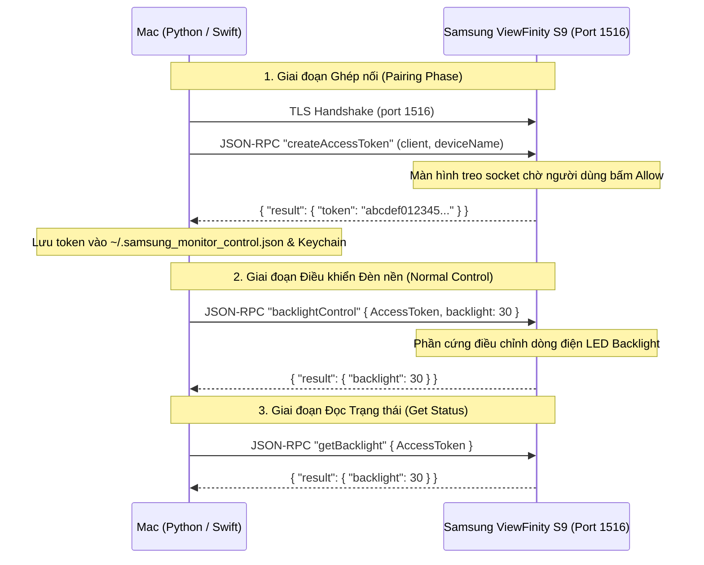

# Kiến trúc Hệ thống & Đặc tả Giao thức Samsung IP Control

Tài liệu này cung cấp chi tiết kỹ thuật về giao thức truyền thông, cấu trúc gói tin JSON-RPC 2.0, so sánh các cổng kết nối và cơ chế điều khiển phần cứng của dòng màn hình Samsung ViewFinity S9.

---

## 1. So sánh cổng kết nối Tizen: Cổng 1516 vs Cổng 8002

Một trong những lý do khiến các giải pháp điều khiển màn hình phổ biến hiện nay thất bại trên Samsung ViewFinity S9 là chọn sai cổng giao tiếp:

| Tiêu chí | Cổng 8002 (Tizen Remote WebSocket) | Cổng 1516 (Samsung IP Control G2) |
| :--- | :--- | :--- |
| **Mục đích thiết kế** | Điều khiển Smart TV từ ứng dụng SmartThings hoặc remote ảo trên điện thoại | Tích hợp hệ thống tự động hóa nhà cao cấp (Crestron, Savant, Control4, RTI) |
| **Giao thức mạng** | WebSocket qua TLS (`wss://<IP>:8002/api/v2/channels/...`) | HTTPS / Raw TLS Socket JSON-RPC 2.0 |
| **Cơ chế điều khiển** | Gửi phím bấm mô phỏng (ví dụ `KEY_UP`, `KEY_HOME`, `KEY_VOLUP`) | Gọi trực tiếp các hàm API của chip điều khiển Tizen |
| **Khả năng chỉnh đèn nền** | ❌ **Không thể.** Không có lệnh đặt giá trị độ sáng trực tiếp. Phím `KEY_BRIGHTNESSUP` chỉ kích hoạt menu cài đặt OSD của Tizen nổi lên màn hình làm gián đoạn công việc. | ✅ **Trực tiếp.** Cung cấp lệnh `backlightControl` với tham số giá trị số `0` đến `50`. Thay đổi đèn nền LED tức thì mà không hiển thị OSD của màn hình. |
| **Cách DisplayBuddy xử lý** | Dùng cổng 8002, nhưng vì không chỉnh được phần cứng nên âm thầm chuyển sang **Software Dimming** (phủ lớp mờ đen làm hỏng màu màn hình) | Dự án này **không dùng** cổng 8002. |

---

## 2. Đặc tả Giao thức Samsung IP Control (Cổng 1516)

- **Cổng TCP:** `1516`
- **Mã hóa:** TLS (Sử dụng chứng chỉ tự ký do firmware Samsung tự sinh)
- **Chuẩn trao đổi dữ liệu:** JSON-RPC 2.0

### Sơ đồ luồng dữ liệu (Message Flow)



---

## 3. Chi tiết các phương thức JSON-RPC 2.0

### 3.1. Phương thức Ghép nối: `createAccessToken`
Khởi tạo phiên ghép nối an toàn giữa máy Mac và màn hình.

**Yêu cầu gửi đi (Request):**
```json
{
  "jsonrpc": "2.0",
  "method": "createAccessToken",
  "params": {
    "client": "macOS",
    "deviceName": "MacBook Pro",
    "timestamp": 1713340800
  },
  "id": 1
}
```

**Phản hồi thành công (Response):**
```json
{
  "jsonrpc": "2.0",
  "result": {
    "token": "4a8f9c1b2e3d4f5a6b7c8d9e0f1a2b3c",
    "status": "success"
  },
  "id": 1
}
```

---

### 3.2. Phương thức Điều chỉnh Độ sáng: `backlightControl`
Truyền giá trị độ sáng mong muốn từ 0 đến 50.

**Yêu cầu gửi đi (Request):**
```json
{
  "jsonrpc": "2.0",
  "method": "backlightControl",
  "params": {
    "AccessToken": "4a8f9c1b2e3d4f5a6b7c8d9e0f1a2b3c",
    "backlight": 25
  },
  "id": 2
}
```

**Phản hồi thành công (Response):**
```json
{
  "jsonrpc": "2.0",
  "result": {
    "backlight": 25,
    "status": "success"
  },
  "id": 2
}
```

---

### 3.3. Phương thức Đọc Độ sáng: `getBacklight`
Đọc mức đèn nền vật lý hiện tại của màn hình.

**Yêu cầu gửi đi (Request):**
```json
{
  "jsonrpc": "2.0",
  "method": "getBacklight",
  "params": {
    "AccessToken": "4a8f9c1b2e3d4f5a6b7c8d9e0f1a2b3c"
  },
  "id": 3
}
```

**Phản hồi thành công (Response):**
```json
{
  "jsonrpc": "2.0",
  "result": {
    "backlight": 25
  },
  "id": 3
}
```

---

## 4. Bảng mã lỗi JSON-RPC (Error Codes)

| Mã lỗi | Tên lỗi | Nguyên nhân & Hướng giải quyết |
| :--- | :--- | :--- |
| `-32700` | `Parse Error / Unpaired` | Token không chính xác, đã hết hạn hoặc thiết bị đã bị xóa khỏi danh sách được cấp quyền trên Tizen. Cần chạy lại lệnh `pair`. |
| `-32010` | `Pairing Rejected / Timeout` | Người dùng đã bấm nút **Deny (Từ chối)** trên remote, hoặc để quá 60 giây không phản hồi popup cấp quyền trên màn hình. |
| `-32601` | `Method Not Found` | Lệnh gọi không được firmware màn hình hỗ trợ. |
| `-32602` | `Invalid Params` | Tham số `backlight` nằm ngoài dải `0 - 50` hoặc thiếu trường `AccessToken`. |

---

## 5. Tối ưu hóa Kết nối và Hiệu năng Mạng

1. **Bảo mật TLS:** Màn hình sử dụng chứng chỉ SSL tự ký không được ký bởi Certificate Authority công khai. Client cấu hình context TLS với chế độ bỏ qua xác thực chuỗi tin cậy CA nhưng lưu lại Fingerprint của chứng chỉ để xác thực thiết bị ở các lần gọi sau.
2. **Debounce & Rate Limiting:** Chip xử lý Tizen trên bo mạch màn hình không được tối ưu để nhận hàng trăm kết nối socket liên tục mỗi giây. Khi kéo thanh trượt trên giao diện, cơ chế Debounce 100ms trên Swift và `Min time between actions = 0.2s` trên BetterDisplay đảm bảo socket chỉ được mở khi cần thiết, đóng socket dứt điểm sau khi nhận phản hồi (`SO_LINGER`), tránh cạn kiệt tài nguyên mạng của màn hình.
