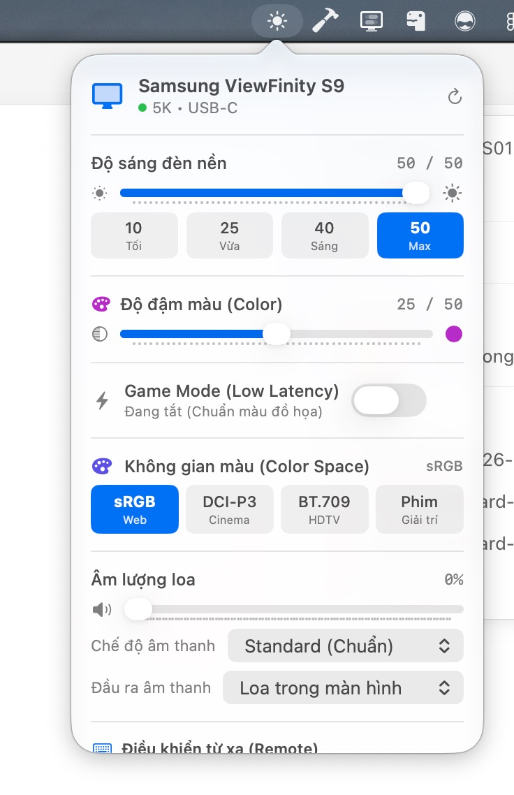
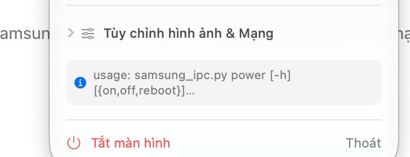

# Audit và sửa UI native macOS — 2026-10-18

## Trạng thái mới nhất: panel nhiều màn hình, DDC và bàn phím

Các quyết định 4 tab/overview tile lớn phía dưới là lịch sử, đã được thay thế trong lượt sửa tiếp theo. Nguồn mới nhất là ảnh Control Center do người dùng cung cấp và menu bar BetterDisplay được đọc/chụp trực tiếp bằng Computer Use. BetterDisplay hiển thị LG ULTRAFINE và S27C900P thành các nhóm riêng với độ sáng phần cứng. Không đổi resolution hoặc cài đặt BetterDisplay trong lượt tham khảo.

### Phân cấp và flow đang triển khai

- Màn đầu hiển thị Samsung ViewFinity S9 qua mạng cùng các màn hình đọc được DDC, mỗi màn hình một slider riêng. Bỏ bộ chọn màn hình lồng submenu và tile power lớn.
- Tên màn hình có chevron mở cấu hình; biểu tượng bàn phím chọn đích F1/F2 và lưu UUID. LG chỉ dùng bộ điều khiển DDC của nó, không gửi nhầm lệnh mạng Samsung. Nếu màn được chọn bị ngắt, phím không chuyển ngầm sang màn khác.
- Hàng thao tác Samsung: Remote mở đúng vị trí Remote; Áp lại nét gọi refresh-sharpness; Tắt S9 gửi power off. Các hành động có text, help và nhãn accessibility, tránh dùng camera.filters như biểu tượng reset.
- Panel ngoài trong suốt; các module dùng glassEffect/GlassEffectContainer ở macOS 26+, Material fallback ở phiên bản thấp hơn. Không có mũi tên NSPopover. Slider dùng NSSlider thật với track tùy biến và NSGlassEffectView làm núm 24×20pt; vẫn giữ target/action, bàn phím và accessibility của AppKit.
- Remote keyboard được lưu bằng UserDefaults. Quay về màn đầu giữ lựa chọn; event chỉ được xử lý trong panel đang mở và bỏ qua text field/modifier. Đóng panel không biến thành global remote.
- F1/F2 là tính năng riêng, bật ở Cài đặt màn hình → Màn hình & phím độ sáng. App yêu cầu quyền Trợ năng qua API macOS; không tự cấp quyền. Event tap xử lý F1/F2 thông thường và brightness media key, chỉ nuốt phím khi đích khả dụng. Cần nghiệm thu quyền, key repeat và tranh chấp nếu BetterDisplay cũng bắt cùng phím.

### DDC: nguồn, hiệu chỉnh và bằng chứng phần cứng

Đã nhúng source MIT của waydabber/m1ddc tại commit `04d949794102eb8df01ad3681afff6464a3eede2` trong `vendor/m1ddc`, giữ LICENSE, build helper vào Resources và ký ad-hoc. Helper này dành cho Apple Silicon; không tuyên bố hỗ trợ Intel hoặc mọi cáp/adapter/màn hình.

LG ULTRAFINE UUID `345E8820-588D-4CEF-A9B8-1A0E5523690B` được phát hiện. Đọc với thời gian chờ 10ms có thể trả toàn byte 0 mặc dù I2C báo thành công. Tăng DDC_WAIT lên 50ms thu được reply hợp lệ `6e 88 02 00 10 00 00 64 00 64 a4`; current/max cùng 100. Đã sửa lỗi upstream `sizeof(2)` thành sizeof biến UInt16 để không ghi tràn bộ nhớ; kiểm tra header, result, VCP code và checksum của reply, từ chối zero/stale packet.

Kiểm tra trên LG thật: đọc 100/100, ghi 99, đọc 99, ghi trả 100, đọc 100. Đây là bằng chứng RPC DDC read/write, chưa phải đo quang học. Samsung S27C900P không phản hồi DDC; đường mạng vẫn được dùng. UI chỉ bật điều khiển DDC khi đọc current/max hợp lệ; ghi debounce trên serial queue và đọc lại để xác nhận. Hotplug kích hoạt quét lại.

### Kiểm chứng và giới hạn hiện tại

Build Swift/AppKit/SwiftUI và đóng gói app đã pass; 10 Python regression tests pass; git diff --check pass ở lượt kiểm tra gần nhất. Có warning onChange deprecated do giữ overload tương thích cũ. Đã chụp/render nhiều vòng trước lần đổi sang panel nhiều màn hình, phát hiện và sửa tile kéo giãn, slider lặp nhãn, viền kép, clipping nút cuối và nền ngoài.

Computer Use lấy được cây AX và ảnh menu bar BetterDisplay. Chọn Control Center và app Samsung qua Computer Use trả timeout; không báo đạt 1:1 hoặc đã kiểm tra VoiceOver/key event thật. Còn nghiệm thu trực tiếp: panel nhiều màn hình mới nhất, mở đúng section, quyền F1/F2, key repeat, memory remote qua đóng/mở và vật liệu trên nền sáng/tối. Tham khảo: https://github.com/waydabber/m1ddc và https://github.com/waydabber/BetterDisplay .

## Phạm vi và nguồn bằng chứng

Yêu cầu: audit trước khi sửa, sắp xếp slider/shortcut hợp lý, đưa tắt màn hình đến vị trí dễ tìm, sửa logic tắt màn hình, dùng hoàn toàn control native Apple. Giữ SwiftUI/AppKit và giao thức Python hiện có; không dùng Figma vì chưa có file thiết kế. Không thêm dependency, không commit/push.

Hai ảnh do người dùng cung cấp trong phiên này được dùng làm bằng chứng trước sửa. Đây là audit ảnh kết hợp đọc code, không phải một lượt thao tác trực tiếp đầy đủ trên phần cứng. Công cụ Computer Use chọn app menu bar bị timeout trước khi mở được popover; không suy ra VoiceOver, keyboard focus hay mọi trạng thái từ ảnh.

## 1. Mở điều khiển — cần sửa phân cấp

Điểm tốt: tên màn hình, nguồn vào, giá trị và preset đèn nền rõ ràng. Vấn đề: độ đậm màu, Game Mode và không gian màu đứng trước âm lượng; remote chỉ bắt đầu ở mép dưới ảnh. ScrollView giấu thanh cuộn trong code làm nội dung phía dưới khó khám phá. Nhiều cỡ chữ cố định 9–12pt và các pill tùy biến tăng mật độ nội dung.

Quyết định: header và hành động nguồn cố định, bốn tab native. Tab Nhanh gom đèn nền/preset/âm lượng/mute và profile âm thanh. Hình ảnh gom không gian màu/Game Mode/các chỉnh sửa màu. Remote chứa D-pad, phím chức năng và hướng dẫn. Kết nối chứa ghép nối, nguồn vào và USB. Mỗi tab có vùng cuộn hiển thị indicator, header không cuộn theo. GroupBox, Button, Toggle, Picker, Slider và DisclosureGroup dùng giao diện hệ thống, không vẽ lại native control.

## 2. Tắt màn hình — lỗi chức năng đã xác định

Ảnh cho thấy lỗi argparse `power [{on,off,reboot}]` sau thao tác tắt, nhưng lỗi bị rút gọn và nằm cuối nội dung. Đọc code xác nhận app gọi `power powerOff`; argparse chỉ nhận `on`, `off`, `reboot`. Hàm Python `control_power` mới ánh xạ `off` sang RPC `powerControl` với `{"power":"powerOff"}`.

Sửa: nút trên header gửi `off`; khóa lặp trong thời gian gửi; hiện thông báo chờ/thành công/lỗi. Sau thành công, trạng thái kết nối chuyển thành chưa kết nối; nút làm mới vẫn có để đọc lại. Kết quả CLI thành công là bằng chứng RPC hoàn tất, chưa phải quan sát panel vật lý tắt. App không quảng cáo khả năng bật lại qua mạng; hướng dẫn dùng remote.

## 3. Remote và bàn phím — lỗi logic từ code

Code cũ bắt mũi tên, Enter, Esc, M, H, số khi popover mở và còn có global key monitor nhận phím từ app khác. Điều này tranh chấp với slider, menu, điều hướng và ứng dụng đang dùng. Bản mới bỏ global key monitor, chỉ chuyển phím thành remote khi ở tab Remote, chủ động bật chế độ bàn phím, app nhận local key event và không có Command/Control/Option. TextField vẫn được miễn chặn. Đổi tab hoặc đóng popover tắt chế độ; giữ Escape là Back chỉ trong chế độ remote đã bật.

D-pad và Home/Menu/Back là Button native có nhãn. Developer Mode được giữ trong disclosure riêng. Chưa kiểm tra đầy đủ focus/VoiceOver trực tiếp.

## 4. Hình ảnh và kết nối — lỗi logic từ code

- Game Mode là Picker Off/On/Auto, không dùng Toggle Boolean làm mất Auto. Bỏ mô tả ngụ ý Off chắc chắn chuẩn màu hoặc On chắc chắn phản hồi tức thì.
- Picture mode ánh xạ cả tên và mã từ Python về tag Picker ổn định; giữ giá trị không biết thay vì chọn nhầm preset.
- Lỗi ghi các Picker trả UI về giá trị trước khi gửi. Slider vẫn dùng debounce hiện có; chưa bổ sung readback/rollback từng lệnh slider trong phạm vi lượt này.
- Không hiển thị chấm xanh cố định: chỉ báo đã kết nối sau khi đọc JSON trạng thái thành công. Điều khiển nhanh/hình ảnh/remote khóa khi chưa có trạng thái, đang đọc, ghép nối hoặc gửi lệnh nguồn.
- Ghép nối không ghi đè IP trên UI trước khi thành công; trim khoảng trắng, không nhận host rỗng, chặn bấm lặp. Cấu hình vẫn do Python lưu.
- USB trong Python đọc thiết bị trên Mac; đổi nhãn để không khẳng định mọi thiết bị đều cắm qua hub màn hình.

## Adaptation và thành phần

Popover là panel menu bar 400×560pt, tăng từ 295pt để chứa nhãn tiếng Việt và bốn tab. Header/footer cố định, mỗi pane cuộn theo vùng. Dùng system text styles, không fixed height cho text, không áp custom background/corner radius cho control. Đây là kích thước phục vụ panel cố định, không phải xác nhận mọi cấu hình màn hình hay cỡ chữ.

Không có yêu cầu port iOS/iPad hoặc tạo web app. API mới hơn macOS 12 không được chủ động đưa vào. `onChange(of:perform:)` được giữ để tương thích macOS 12 dù SDK hiện tại báo deprecated; chưa chạy trên máy macOS 12.

Tham khảo ảnh MonitorControl để đối chiếu cách ưu tiên brightness/volume; không sao chép artwork hay thêm ảnh mạng vào app. Tham khảo native Slider từ Explore SwiftUI và xác minh Slider/SegmentedPickerStyle/accessibilityLabel bằng Xcode DocumentationSearch. TabView dùng tab native cho các nhóm tác vụ; Picker chọn giá trị, không dùng custom pill làm tab.

- https://macmenubar.app/app/monitor-control
- https://exploreswiftui.com/library/slider/slider
- https://developer.apple.com/documentation/swiftui/slider
- https://developer.apple.com/design/human-interface-guidelines/sliders (web trả trang yêu cầu JS; không dùng làm bằng chứng chi tiết API)

## Kiểm chứng và giới hạn

- `xcrun swiftc -typecheck main.swift -framework Cocoa -framework SwiftUI`: pass; warning deprecation của onChange tương thích cũ.
- `./build.sh`: pass, compile tối ưu, đóng gói/ký ad-hoc, cài `/Applications/Samsung Monitor Control.app` và launch. Script cài đặt hiện có được giữ nguyên.
- `python3 -m unittest discover -s tests -v`: kiểm tra argparse `power off` đi tới đúng RPC bằng mock; lỗi RPC không trả thành công. Không gọi màn hình trong test.
- Chưa gửi lệnh power thật trong lượt này; chưa có bằng chứng tắt panel vật lý hoặc bật lại bằng remote.
- Chưa xác nhận giao diện sau sửa, dark mode, VoiceOver, keyboard focus, màn hình thấp hoặc long error text qua runtime. Không coi compile là visual acceptance.
- Còn giới hạn hiện có: CLI chạy process đồng bộ trong background, nhiều lệnh slider có thể chồng nhau; lỗi slider giữ giá trị UI lạc quan, chưa xác nhận khả năng từng control theo firmware. Không tuyên bố đã sửa mọi lỗi giao thức.

## Checklist nghiệm thu tiếp theo

1. Mở biểu tượng menu bar, xác nhận Nhanh chứa brightness/volume và nút Tắt luôn ở header.
2. Chuyển bốn tab, cuộn Hình ảnh/Kết nối, mở chi tiết thông báo dài; xác nhận footer/header vẫn tới được.
3. Dùng Tab/mũi tên trên slider khi remote tắt; không có lệnh remote phát sinh. Bật remote tại tab Remote, kiểm tra arrows/Enter/Esc/M/H/0–9; đổi tab hoặc đóng popover dừng nhận phím.
4. Đọc trạng thái Auto, xác nhận Game Mode không hiện Off. Thử lỗi ghi Picker, xác nhận lựa chọn trước đó được khôi phục.
5. Ghép nối host có khoảng trắng đầu/cuối; xác nhận chỉ cập nhật IP sau thành công và lỗi vẫn có thể đọc hết.
6. Người dùng chủ động bấm Tắt màn hình để xác nhận phần cứng, sau đó bật lại bằng remote và làm mới trạng thái.

## Follow-up: Control Center overview — 2026-10-18

### Bằng chứng và audit trước sửa

Người dùng cung cấp hai ảnh trong phiên này: popover app đã build và Control Center macOS làm tham chiếu. Audit này dựa trên đúng hai ảnh và code `MonitorPopoverView`, không phải sao chép asset hoặc UI nội bộ của macOS.

1. **Phân cấp sai ở trạng thái đầu.** Popover app bắt đầu bằng header, power, status, divider, tab bar, title của tab và GroupBox trước slider. Trong ảnh, brightness/volume chiếm vùng thấp hơn, trong khi thao tác tắt nguồn và chỉnh màu phổ biến bị chia nhỏ bởi chrome. Control Center đặt module hành động và slider trực tiếp trong bề mặt đầu tiên.
2. **Điều hướng bằng bốn tab làm mất ngữ cảnh.** Nhanh, Hình ảnh, Remote và Kết nối là những cột Settings đầy đủ nhưng không phù hợp popover thao tác nhanh. Chúng làm remote/kết nối không thể khám phá từ trạng thái khởi đầu và tạo scrollbar cao trong panel 400×560pt.
3. **Ngôn ngữ hình thức không thống nhất.** `GroupBox`, form picker, bordered button, divider và pill preset có nhiều lớp viền/khung khác nhau. Ảnh Control Center dùng vài card vật liệu đồng nhất, góc liên tục và khoảng cách rộng hơn.
4. **Tắt màn hình chưa đủ nổi bật.** Nút tồn tại trong header nhưng cùng cấp với Kết nối, refresh và status. Hành động có hậu quả rõ ràng cần được nhận diện nhanh và có mô tả phục hồi ngắn.
5. **Khả năng tiếp cận không được suy đoán từ ảnh.** Ảnh không chứng minh focus order, VoiceOver hoặc tương phản khi material thay đổi theo wallpaper. Các Button, Menu, Picker, Slider và Toggle được giữ là controls thật để hệ thống vẫn có semantic/action; nghiệm thu VoiceOver/runtime còn mở.

### Quyết định và triển khai

- Trạng thái mặc định nay là một **overview 420×610pt**: header tên/kết nối/refresh, tile `Tắt màn hình`, tile `Màu`, tile `Độ nét`, module `Màn hình`, module `Âm thanh`, rồi `Tùy chỉnh màn hình…`.
- `Tắt màn hình` thành tile lớn đầu tiên, có biểu tượng power và lời nhắc dùng remote để bật lại. Vẫn gọi cùng lệnh `power off`, vẫn khóa lúc đang gửi và không thay đổi hợp đồng CLI/RPC.
- Độ sáng, âm lượng vẫn dùng `Slider` SwiftUI có nhãn accessibility; preset 10/25/40/50 vẫn là `Button` thật. Mute, menu mode/đầu ra, profile màu và refresh độ nét vẫn gửi các action hiện có của `MonitorModel`.
- `Tùy chỉnh màn hình…` dẫn đến cùng popover với scroll chỉ cho cấu hình sâu: hình ảnh, D-pad/keyboard remote, ghép nối/nguồn vào/danh sách USB. Không bỏ khả năng đã có, chỉ đưa chúng khỏi lớp đầu tiên.
- Dùng `Material`, `RoundedRectangle` liên tục và `ButtonStyle` nội bộ để có mật độ/nhịp gần Control Center. SwiftUI không công bố API cho phép app nhúng hay sao chép Control Center hệ thống; phần layout card là custom để đáp ứng yêu cầu visual, còn interaction giữ control native. Không dùng glass API mới hơn macOS 12.

### Tiêu chí nghiệm thu bổ sung

1. Mở icon menu bar: phải thấy Tắt màn hình, Màu, Độ nét, Màn hình và Âm thanh mà không cuộn hoặc đổi tab.
2. Dùng Tab và VoiceOver trên tile, menu và hai slider; xác nhận mỗi control có tên/hành động hợp lý và preset không làm mất focus.
3. Mở `Tùy chỉnh màn hình…`, thay đổi màu/remote/kết nối, rồi quay lại: giá trị model và trạng thái bàn phím remote phải giữ đúng.
4. Thử Light/Dark Mode, cửa sổ có wallpaper sáng/tối, long error text và cỡ chữ lớn. Cần đánh giá trực tiếp tương phản của material; build không đủ chứng minh.

## Follow-up: sRGB và DCI-P3 bị đảo — 2026-10-18

Người dùng đối chiếu trực tiếp hai chiều: chọn DCI-P3 trong app thì OSD màn hình chọn sRGB, và chọn sRGB trong app thì OSD chọn P3. Đây là bằng chứng hiệu chỉnh nhãn trên ViewFinity S9 của người dùng, không phải bảng mã phổ quát cho mọi firmware Samsung. Ảnh app do người dùng gửi trong lượt này cho thấy nhãn DCI-P3; không có ảnh OSD nên phần đối chiếu OSD dựa trên báo cáo của người dùng.

Lượt đọc RPC chỉ đọc, không đổi cấu hình: `getTVStates` và `pictureModeControl` cùng trả `Gen_327714`; `getVideoStates` không trả picture mode. Mã cũ gán `Gen_327712` cho P3 và `Gen_327714` cho sRGB ở ba vị trí Python và một vị trí Swift. Bảng này trái với đối chiếu hai chiều của người dùng. Việc lặp lại cùng mapping khi đọc/ghi khiến app có vẻ nhất quán dù nhãn không khớp OSD.

Sửa theo hiệu chỉnh S9: `Gen_327712` = sRGB, `Gen_327714` = DCI-P3; BT.709 và các preset còn lại giữ nguyên, chưa hiệu chỉnh bằng OSD trong lượt này. Python có một bảng `PICTURE_MODE_LABELS` dùng cho cả lookup khi ghi và hiển thị khi đọc/status. Swift nhận raw hoặc friendly label với mapping tương ứng. Các alias `preset1…5` vẫn là mã vị trí, không đổi nghĩa. Alias CLI legacy `graphic` giữ nguyên mã cũ và không được trình bày như một lựa chọn OSD riêng.

Khi ghi picture mode, Python không dùng write echo làm xác nhận: đọc `getTVStates` và so raw với target; khác hoặc thiếu mã thì trả lỗi và yêu cầu làm mới. Swift khóa Picker lúc đang gửi/xác nhận, không đổi nhãn lạc quan trước khi có readback, và không mặc định Unknown thành sRGB. Readback một lần có thể chưa thấy firmware áp dụng nếu firmware trả chậm; trường hợp này app báo chưa xác nhận, không tự suy đoán thành công. Đọc raw chỉ xác nhận preset, không chứng minh gamut/color accuracy của panel.

Kiểm chứng: ba regression test mới kiểm tra cả chiều đọc/ghi của sRGB/P3 và BT.709, alias P3, write echo khác readback phải thất bại, unknown raw giữ nguyên; cộng hai power test hiện có là 5 test pass. Build/cài lại bằng `./build.sh`. Không gửi lệnh thay đổi picture mode thật trong lượt kiểm tra tự động này. Còn nghiệm thu: chọn sRGB và P3 trên app đã cài, đối chiếu OSD từng chiều và bấm làm mới xác nhận nhãn vẫn đúng.
