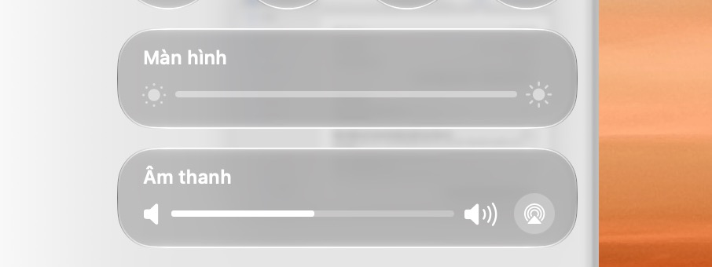
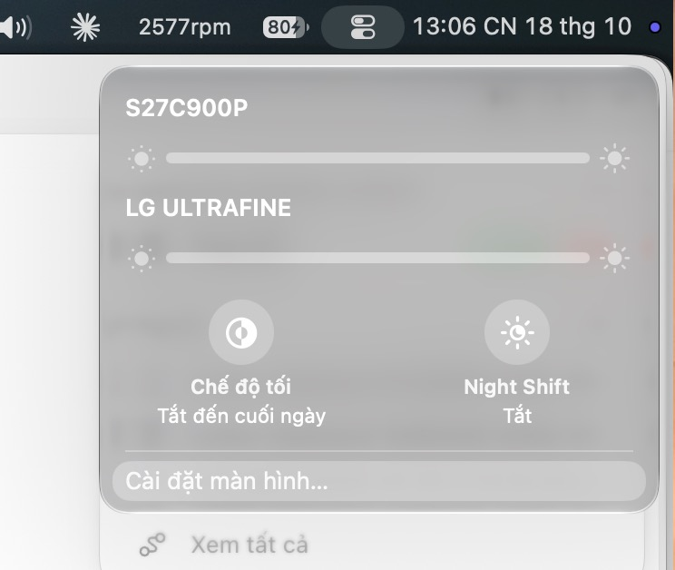
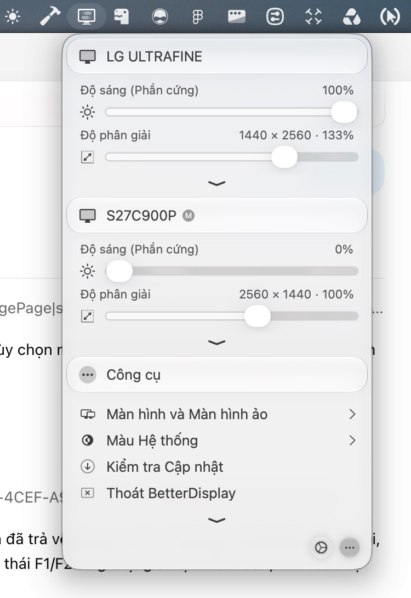
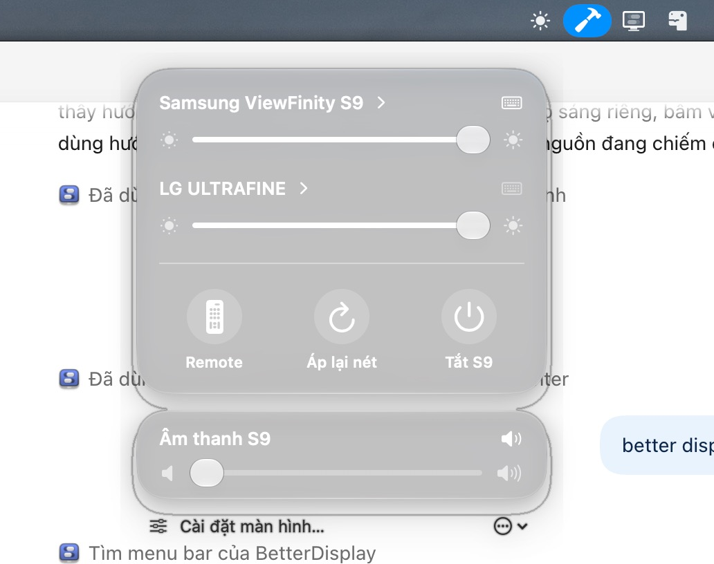

# Samsung Monitor Control — Product Design

Version 1.0 · 2026-10-18 · macOS menu bar utility

### Recovery và khả năng tương tác — cập nhật 2026-10-18

- Ngắt DDC là tạm thời trong phiên sử dụng. Lưu ý định khôi phục trước khi ngắt; khi app chạy lại hoặc chạy sau đăng nhập, tự thử kết nối lại các màn còn lưu. Chỉ xóa trạng thái khôi phục sau khi macOS xác nhận màn active với đúng định danh. Không hiển thị thành công chỉ từ kết quả gửi lệnh.
- Khi màn disable làm mất UUID, nhận diện lại bằng vendor/model/serial đã lưu; chỉ dùng kết quả duy nhất. Nếu không phân biệt được hai màn giống nhau hoặc cáp đã rút, giữ thao tác Kết nối lại và thông báo cụ thể, không chọn đại display ID.
- Bật phím tắt có hai trạng thái: người dùng yêu cầu bật và bộ bắt phím đã sẵn sàng. Giữ yêu cầu bật trong lúc chờ AX; tự nhận lại quyền, không hiện hộp xin quyền lặp. Tắt toggle hủy chờ. Đổi chữ ký build không được coi là quyền đã được macOS cấp cho bản mới.
- Nút Back của mọi menu con có vùng bấm tối thiểu 44×44 pt, bao quanh icon; không bắt người dùng click chính xác nét chevron.
- Bằng chứng, hành vi login item và các gate chưa kiểm tra: [Reconnect / keys / Back](../audits/2026-10-18-native-ui/RECONNECT_KEYS_BACK.md).

**Trạng thái:** đặc tả thiết kế đã tổng hợp, chờ review trước khi tiếp tục coding. Yêu cầu trực tiếp của người dùng là ràng buộc đã chốt; cách bố trí và thông số dưới đây là đề xuất triển khai, chưa phải visual acceptance. Code hiện có là prototype đang thử nghiệm, không phải bản chuẩn để sao chép.

### Cập nhật sau yêu cầu “tiếp tục” và QC appearance

**Khôi phục khả năng đọc:** thử `.clear` nguyên bản làm foreground sáng chìm hoàn toàn trên nền trắng trong ảnh người dùng. Đã bỏ thử nghiệm đó, trở lại `.regular` native + Dark Aqua, không dim/tint/shadow tùy chỉnh. Đây là baseline đọc được để sửa tiếp, không tuyên bố đạt visual 1:1. Không thử biến thể glass mới trên app chính chỉ dựa vào build; phải đối chiếu ảnh trên nền sáng trước khi bàn giao.

**Thử nghiệm appearance mới nhất:** người dùng thấy regular quá đục và yêu cầu “glass small”. API `Glass` không có small; thử `Glass.clear` nguyên bản cho nền widget, giữ dark appearance và không thêm dim/tint/shadow tùy chỉnh. Đây là thử nghiệm mới thay cho regular bên dưới, chưa visual accepted. Thumb giữ appearance Aqua riêng; không đổi track trắng.

Người dùng đã yêu cầu tiếp tục triển khai, sau đó chốt thêm: các widget giữ appearance tối như Control Center và text/slider sáng; Cài đặt thành ô riêng; bấm nền/tiêu đề ô mở detail, không bắt buộc đúng chevron. Slider được tách idle (núm trắng) và dragging (núm kính lớn). Khu vực slider chỉ điều chỉnh giá trị, không kích hoạt điều hướng của nền ô.

Đã triển khai overview hai module sync → detail riêng, bỏ 735 dòng layout thử nghiệm trong view và thay bằng flow gọn. Độ sáng sync được tiến hành theo giả định đã thông báo khi người dùng yêu cầu tiếp tục; âm lượng sync là yêu cầu trực tiếp đã chốt. Áp lại nét/Remote/Tắt nguồn chỉ gọi Samsung.

QC thực tế qua Computer Use đã lấy được overview và mở Audio detail với cả Samsung/LG. Thử nghiệm `Glass.clear` kèm dim/shadow tùy chỉnh đã bị người dùng từ chối vì quá trong và có cảm giác tự chế. Theo yêu cầu mới nhất “glass medium”, bản hiện tại dùng **`Glass.regular` nguyên bản** (API SwiftUI có regular/clear/identity, không có medium), không lớp dim, không tint, không shadow View tùy chỉnh. Giữ semantic foreground trong Dark Aqua, margin trong suốt 24pt và tắt NSPanel window shadow để tránh viền cửa sổ kép. Nguồn API: https://developer.apple.com/documentation/swiftui/glass/regular .

Dark appearance cần đặt cả trên NSPanel/NSHostingController lẫn SwiftUI; chỉ `.environment(colorScheme: .dark)` trên modifier chưa làm glass AppKit đổi đúng trong thử nghiệm. Slider trắng vẫn giữ; núm kính chỉ hiện trong mouseDown tracking. Không dùng NSVisualEffectView/sidebar material để gọi là Liquid Glass.

**Hiệu chỉnh thumb kéo:** widget tiếp tục `Glass.regular` mặc định. `NSGlassEffectView` của thumb dùng regular với appearance Aqua riêng để không kế thừa Dark Aqua thành cục xám đen. Track vẫn dùng màu nhãn sáng của widget tối; không đổi màu track theo Aqua của thumb. Vùng layout slider 24pt chứa đủ thumb kính 20pt để tránh clipping theo chiều cao. Cần QC trong lúc kéo, không chỉ ảnh sau thả.

Build/cài gần nhất pass; Computer Use menu con cuối cùng timeout. Còn gate: đối chiếu độ tối/trong trên nền sáng/tối, shadow clipping cuối cùng, video morph, thử kéo sync/riêng trên hai thiết bị và shortcut thật. Trạng thái **in-progress, chưa accepted**; các đoạn “dừng coding” trong lịch sử phía dưới chỉ mô tả thời điểm trước yêu cầu tiếp tục.

**Chủ sở hữu quyết định:** người dùng/product owner. Codex chịu trách nhiệm đặc tả, triển khai sau bước review và thu thập bằng chứng QC. Tài liệu này sở hữu quyết định sản phẩm/IA/interaction; [status tracker](../engineering/IMPLEMENTATION_STATUS.md) sở hữu tiến độ; [audit](../audits/2026-10-18-native-ui/AUDIT.md) sở hữu lịch sử phát hiện lỗi.

## 1. Định hướng sản phẩm

Ứng dụng giúp người dùng Mac điều khiển Samsung ViewFinity S9 nhanh như một màn hình Apple: độ sáng phần cứng, âm lượng, remote, cấu hình hình ảnh và tắt màn hình. Khi có thêm màn hình LG/DDC, người dùng vẫn chỉnh được độ sáng, âm lượng và kết nối trong cùng app.

Samsung là trung tâm sản phẩm. BetterDisplay cung cấp tham chiếu cách tổ chức nhiều màn hình và điều khiển theo từng thiết bị; macOS Control Center cung cấp hình thức, cấu trúc overview → detail và chuyển động. Không mở rộng thành bộ quản lý màn hình đầy đủ.

### Kết quả người dùng cần đạt

1. Mở icon menu bar, chỉnh độ sáng/âm lượng nhanh, không cần tìm trong nhiều tab hoặc menu lồng nhau.
2. Từ một slider ngoài, đồng bộ âm lượng các màn hình; mở vào trong để chỉnh riêng Samsung/LG.
3. Dùng phím độ sáng/âm lượng cho màn hình có con trỏ, không cần chọn đích cố định.
4. Truy cập remote, khôi phục độ nét và tắt Samsung bằng icon có nghĩa và nhãn dễ hiểu.
5. Ngắt màn DDC và kết nối lại từ app, không bị mất đường phục hồi.

### Ràng buộc đã chốt từ người dùng

| Mã | Quyết định |
| --- | --- |
| R01 | Giao diện/layout theo macOS Control Center; ưu tiên fidelity và tự QC trực quan. |
| R02 | Tham khảo menu bar BetterDisplay, không dùng cửa sổ Settings của nó làm thiết kế chính. |
| R03 | Chỉ essential; tập trung Samsung, DDC bổ sung độ sáng/âm lượng/ngắt-kết nối. |
| R04 | Không chỉnh màu DDC. Đây là câu trả lời xác nhận trực tiếp của người dùng. |
| R05 | Khôi phục độ nét chỉ dành cho Samsung. |
| R06 | Kéo âm lượng bên ngoài = sync; bấm vào trong = chỉnh riêng từng màn. |
| R07 | Phím độ sáng/âm lượng theo màn hình dưới con trỏ. |
| R08 | Nhớ lựa chọn dùng bàn phím remote khi quay lại menu ngoài. |
| R09 | Liquid Glass thật, có morph khi vào/ra và giữa các menu trong; hỗ trợ Reduce Motion. |
| R10 | Bỏ nền bao ngoài của overview; giảm spacing và nội dung thừa; sửa viền kép/focus và clipping. |
| R11 | Tổng hợp product design trước khi tiếp tục coding. |

## 2. Phạm vi essential

| Chức năng | Samsung S9 | Màn DDC |
| --- | --- | --- |
| Độ sáng phần cứng | Mạng, mức thiết bị 0–50 | VCP luminance, theo max đọc được |
| Âm lượng | Mạng 0–100, mute | VCP volume nếu có capability hợp lệ |
| Đồng bộ âm lượng ngoài | Tham gia khi khả dụng | Tham gia khi đọc/ghi volume được |
| Điều chỉnh riêng | Có | Có |
| Phím theo con trỏ | Độ sáng, âm lượng, mute | Capability nào có thì điều khiển capability đó |
| Chọn màu/Game Mode/contrast/color/sharpness | Giữ chức năng hiện có trong menu Samsung | Không |
| Khôi phục độ nét | Có, một lần bấm | Không |
| Remote và nhập phím | Có | Không |
| Tắt nguồn | Samsung power off | Không giả làm power off bằng disconnect |
| Ngắt/kết nối desktop | Không phải hành động chính | Logical disconnect/reconnect, nếu macOS hỗ trợ |
| Ghép nối IP và USB inventory | Cấu hình nâng cao Samsung | Không |

Ngoài phạm vi: resolution/scaling/HiDPI, virtual display, streaming/PIP, HDR/XDR boost, ICC/LUT, Night Shift/dark mode, ambient sensor, đồng bộ màu, định tuyến USB vật lý, tự bật Samsung qua mạng, cập nhật firmware, chỉnh volume của mọi thiết bị âm thanh macOS. Không thêm các nút của Control Center khi app không thực hiện chức năng đó.

## 3. Nguồn tham chiếu và audit

### Nguồn visual



Ảnh do người dùng cung cấp: module Màn hình/Âm thanh, hình dạng capsule lớn, track mảnh trong module, núm kính lớn khi tương tác. Đây là target visual, không là asset để đặt vào app.



Ảnh do người dùng cung cấp: tiêu đề từng màn hình, mỗi màn một slider trong cùng khối detail; footer dẫn đến cấu hình. App giữ pattern này, không đưa Dark Mode/Night Shift vào phạm vi.



Ảnh do người dùng cung cấp; Computer Use cũng đọc được AX/menu bar BetterDisplay trực tiếp với LG ULTRAFINE và S27C900P, slider phần cứng riêng. Mượn cách nhận diện thiết bị và capability, không sao chép tất cả chức năng hoặc layout form của BetterDisplay.

### Những lỗi đã thấy và phải tránh



- Tile Tắt màn hình từng chiếm gần nửa panel: hành động thứ cấp áp đảo tác vụ slider.
- Icon camera.filters dùng cho reset độ nét gây hiểu nhầm; icon remote/menu không có nhãn khiến khó khám phá.
- Bộ chọn màn hình qua Picker bên trong Menu tạo hai lần mở; đích cố định trái yêu cầu con trỏ.
- Nội dung Samsung xuất hiện khi đang chọn LG; không đúng phạm vi thiết bị.
- Nhãn Slider bị hiển thị lại bên track; tick/knob nhỏ không đúng ảnh tham chiếu.
- Viền kép/halo dưới các module và nút footer bị cắt: không chấp nhận chỉ vì build pass.
- Tự tắt remote keyboard khi chuyển trang làm mất lựa chọn của người dùng.
- Chưa có QC cuối chứng minh visual 1:1, focus, morphology và key routing. Các ảnh hiện tại không được coi là thiết kế đã được chấp nhận.

## 4. Kiến trúc thông tin

```text
Menu bar icon
└── Overview
    ├── Module Màn hình: độ sáng chung → mở Display detail
    ├── Module Âm thanh: âm lượng chung → mở Audio detail
    ├── Samsung shortcuts: Remote / Áp lại nét / Tắt S9
    └── Cài đặt + More
        ├── Samsung: ghép nối IP, nguồn vào, trạng thái
        ├── Phím tắt: bật/tắt, quyền, quy tắc con trỏ
        ├── Màn DDC: capability, ngắt/kết nối lại
        └── Thoát

Display detail
├── Back + Màn hình
├── Samsung S9: slider riêng, chevron vào cấu hình Samsung
├── LG/DDC: slider riêng, menu thiết bị → ngắt kết nối
├── Thiết bị đã ngắt: Kết nối lại
└── Cài đặt màn hình…

Audio detail
├── Back + Âm thanh
├── Samsung S9: volume, mute, output/mode trong More
├── LG/DDC: volume riêng nếu hỗ trợ
└── Không có thiết bị khả dụng: trạng thái + thử lại

Samsung detail
├── Hình ảnh
├── Remote
└── Kết nối
```

Overview mới không có danh sách slider riêng từng màn. Danh sách đó thuộc Display/Audio detail như ảnh Apple. Đây là quyết định thiết kế để thu gọn bề mặt đầu tiên; prototype gần nhất vẫn còn danh sách ngoài và cần được thay sau review.

## 5. Đặc tả màn hình và layout

### S00 — Menu bar

- Một icon SF Symbol `display` hoặc `sun.max` được chọn nhất quán; accessible name “Samsung Monitor Control”.
- Click mở overview dưới icon, sát mép trên giống panel hệ thống. Click lần nữa hoặc click ngoài đóng.
- Không tự chuyển desktop, không giành phím khi đóng. Command-Q trong panel/menu More để thoát.

### S01 — Overview

Không có khung nền chữ nhật bao toàn bộ các module. Từng module là một lớp Liquid Glass độc lập trong container chung; khoảng trống giữa module trong suốt. Không header tên Samsung lớn lặp lại, trạng thái mạng dài, divider thừa hoặc menu chọn màn hình lồng.

| Thành phần | Nội dung và hành vi |
| --- | --- |
| Module Màn hình | Tiêu đề “Màn hình”, chevron; slider brightness chung; icon sun.min/sun.max. Bấm title/chevron mở S02. |
| Module Âm thanh | Tiêu đề “Âm thanh”, nút mở S03; slider volume chung; speaker.fill/wave.3. Không đặt tên “Âm thanh S9” vì tham gia cả LG. |
| Shortcut Samsung | Remote (`av.remote`), Áp lại nét (`arrow.clockwise`), Tắt S9 (`power`); text ngắn dưới icon. Mỗi nút chỉ tác động Samsung. |
| Footer | Cài đặt màn hình… và More. More chứa làm mới, lỗi chi tiết, thoát. Không footer “Đã kết nối” dài ở trạng thái bình thường. |

Đồng bộ brightness chung là đề xuất thiết kế phù hợp cấu trúc Apple, chưa được người dùng xác nhận rõ như volume. Mặc định dự kiến: cùng phần trăm trên các màn khả dụng; không tuyên bố cùng nits. Nếu review muốn chỉ sync volume thì module Màn hình ngoài là lối vào detail, không áp sync ngầm.

### S02 — Display detail

- Một panel kính gọn, Back ở đầu. Danh sách theo thứ tự Samsung trước, DDC theo tên/UUID ổn định.
- Tên mỗi màn và slider brightness riêng. Không lồng card kính trong card kính.
- Nút More cạnh màn DDC mở “Ngắt kết nối”; thiết bị đã ngắt vẫn có hàng “Kết nối lại”.
- Samsung chevron mở S04; LG không có menu màu/remote/áp nét Samsung.
- Thiết bị không hỗ trợ brightness vẫn có thể hiện trong Cài đặt với lý do, không thêm slider giả ở detail.

### S03 — Audio detail

- Back + Âm thanh. Samsung và LG mỗi màn một volume slider độc lập; icon mute chỉ khi thực hiện được.
- Đơn vị trên UI là phần trăm. DDC max khác 100 được chuẩn hóa, luôn giữ max thiết bị để ghi đúng.
- Samsung output/sound mode hiện có nằm trong More của hàng Samsung. Không mô tả output Samsung như thiết bị USB của Mac.
- Thiết bị không hỗ trợ volume không xuất hiện như slider hoạt động. Có thể xem lý do ở Cài đặt.

### S04 — Samsung detail

Chỉ một nhóm tác vụ hiển thị tại một thời điểm: Hình ảnh, Remote hoặc Kết nối. Không trang cuộn dài chứa tất cả nhóm. Điều hướng có Back về nơi mở và hỗ trợ chuyển giữa ba menu trong bằng title/section control gọn; vị trí lựa chọn dễ nhận biết.

Hình ảnh giữ preset sRGB/DCI-P3/BT.709 và các lựa chọn hiện có; Game Mode Off/On/Auto; color/contrast/sharpness; tint/black level trong disclosure nâng cao. Không đảo mapping đã hiệu chỉnh. Không lặp nhãn slider cạnh track.

Remote dùng D-pad Lên/Trái/OK/Phải/Xuống, Back/Home/Menu, toggle bàn phím và hướng dẫn ngắn. Kết nối chứa IP, ghép nối, đổi nguồn; USB inventory đặt sâu, nhãn “Thiết bị USB trên Mac”. Không thêm fake USB route.

### S05 — Settings essential

Chỉ gồm thiết lập cần để app hoạt động: quyền phím, bật/tắt phím, trạng thái thiết bị, quét lại, ghép nối Samsung và kết nối lại DDC. Không thêm analytics, account hoặc onboarding dài.

### Geometry khởi điểm để triển khai

Các số sau là design tokens đề xuất, cần đo lại với screenshot ở cùng backing scale; không tự nhận là số đo nội bộ của Apple.

| Token | Giá trị khởi điểm |
| --- | --- |
| Panel width | 320pt; kiểm tra khoảng 300–360pt trước khi chốt |
| Inset ngoài | 12pt |
| Gap module | 12pt, không ép sát làm glass tự hợp nhất |
| Module slider | Cao khoảng 64–72pt; title và track trong cùng module |
| Radius | Continuous, khoảng 24–30pt theo kích thước module |
| Thumb | Capsule kính khoảng 24×20pt; hit area ít nhất 28pt cao |
| Detail title | System 13–14pt semibold |
| Text control | System 12–13pt; caption chỉ dùng cho thông tin phụ |
| Panel height | Theo nội dung, không có Spacer kéo tile; chỉ cuộn khi vượt màn hình |

Không dùng chữ trắng trên nền trong suốt ở footer mà không có vật liệu đỡ tương phản. Không ép tất cả foreground thành trắng bất kể nền; kiểm tra Light/Dark và wallpaper sáng/tối. Không chồng tint/background/outline tùy biến để giả glass.

## 6. Hợp đồng đồng bộ và chỉnh riêng

### Âm lượng chung — yêu cầu đã chốt

1. Slider ngoài nhận target phần trăm 0–100.
2. Chụp tập thiết bị đang hỗ trợ volume ở lúc bắt đầu thao tác; Samsung phải online và DDC phải có current/max hợp lệ.
3. Ghi Samsung cùng phần trăm; DDC ghi round(percent × max / 100). Không chỉnh CoreAudio output của Mac.
4. Từng thiết bị có queue/debounce riêng; thao tác cuối cùng thắng. Thiết bị hỏng không chặn thiết bị khác.
5. Kéo slider riêng không kéo các màn khác. Mở/quay về không tự đồng bộ.
6. Khi các màn khác mức, overview lấy giá trị trung bình phần trăm của các màn khả dụng làm điểm hiển thị và accessible description “Các màn hình đang có mức khác nhau”. Chỉ khi người dùng kéo mới ghi chung.
7. Khi có lỗi một phần, không báo toàn bộ thành công: “Đã chỉnh Samsung; chưa chỉnh được LG. Thử lại”. Không rollback các màn đã ghi thành công.
8. Không tự unmute Samsung hoặc đổi đầu ra khi tăng volume. Mute riêng cần phân biệt với volume = 0. DDC mute không dùng mức 25% giả làm khôi phục; lưu mức trước mute hoặc không hiện mute nếu chưa có hợp đồng chính xác.

### Read/write và state

UI có thể phản hồi vị trí ngay trong lúc kéo; giá trị được đánh dấu pending. Sau khi dừng, readback quyết định committed value. Readback khác target hiện giá trị thật và lỗi gọn. Kết quả cũ không được ghi đè thao tác mới. Giới hạn lệnh Samsung theo queue để tránh nhiều process đồng thời.

## 7. Phím tắt theo con trỏ

| Phím | Hành động |
| --- | --- |
| Brightness down / F1 | Giảm brightness màn dưới con trỏ |
| Brightness up / F2 | Tăng brightness màn dưới con trỏ |
| Mute / F10 | Mute màn dưới con trỏ nếu hỗ trợ |
| Volume down / F11 | Giảm volume màn dưới con trỏ |
| Volume up / F12 | Tăng volume màn dưới con trỏ |

- Resolve NSScreen tại mỗi lần nhấn; map CGDisplay UUID với backend. Không hardcode tên S27C900P làm identity lâu dài.
- Phím khác với slider sync: phím chỉ chỉnh một màn hình dưới con trỏ.
- Màn builtin/không hỗ trợ/mất kết nối: không nuốt phím để macOS hoặc app khác xử lý; không tự fallback sang Samsung.
- Mỗi lần nhấn khoảng 1/16 range, clamp min/max, giữ repeat ổn định. Fn/media-key mode đều cần test.
- Modifier Command/Control/Option/Shift đi qua, trừ tổ hợp riêng được bổ sung sau này. Không tự cướp tổ hợp đang dùng.
- Quyền Trợ năng giải thích đúng lúc bật, không tự cấp quyền; khi thiếu quyền slider vẫn hoạt động.
- Nếu BetterDisplay cũng bắt phím, hướng dẫn chỉ bật một app cho cùng phím. Không tự sửa setting BetterDisplay.

## 8. Remote và khôi phục độ nét Samsung

### Remote keyboard

Lựa chọn toggle lưu qua chuyển trang và lần mở app. Khi panel mở, arrows/Enter/Esc/M/H/số gửi Samsung nếu toggle bật và Samsung online; các text field, picker/menu đang chỉnh giá trị và control cần arrows được ưu tiên. Không bắt phím remote khi panel đóng hoặc app khác có focus. D-pad hoạt động độc lập toggle. Remote đang bật cần indicator ngắn để người dùng biết arrows sẽ đi đâu.

### Áp lại nét

Một lần bấm chụp target người dùng đang đặt, đổi lệch 1 mức hợp lệ rồi trả target sau 150ms; ở min 0 đi lên 1 rồi về 0, ở mức khác ưu tiên giảm 1 rồi trả. Luôn thử restore nếu bước đầu timeout; đọc lại xác nhận. Khóa bấm lặp và sharpness slider trong thời gian thao tác. Không tự chạy lúc wake trong phạm vi này. Không lưu một target khác ngoài giá trị người dùng đang chỉnh mà không có UI giải thích.

Chỉ hiện dưới nhãn Samsung hoặc ở Hình ảnh Samsung; tuyệt đối không đưa vào LG/DDC detail hoặc gọi DDC sharpness.

## 9. Tắt Samsung và ngắt DDC

Tắt S9 gọi CLI `power off` → powerControl powerOff; trạng thái gửi/xong/lỗi rõ ràng, chống bấm lặp. Không quảng cáo nút bật lại nếu mạng không hỗ trợ; help “Dùng remote để bật lại”. Hành động này không gọi disconnect desktop.

Ngắt DDC là logical disconnect khỏi desktop, không phải cắt nguồn/brightness = 0. Phải giữ ít nhất một màn active. Lưu identity UUID để dòng Kết nối lại tồn tại khi display biến mất khỏi public online list; resolve ID mới từ WindowServer trước mỗi transaction. Không dùng integer display ID đã cache để bật lại thiết bị khác.

Kết nối lại có nút tại overview/detail/settings, retry giới hạn và readback trạng thái thật. Nếu private API không có, hiện unsupported, không báo success. Cần đường “Kết nối lại tất cả màn đã ngắt bởi app”; không bật ngầm các màn người dùng tắt bằng công cụ khác. Nếu app thoát/crash, phải có hướng phục hồi bằng replug/wake; cân nhắc tự reconnect các màn do app ngắt khi thoát bình thường sau review.

## 10. Liquid Glass và motion

- Dùng API công khai glassEffect, GlassEffectContainer, glassEffectID, glassEffectTransition trên macOS 26+, NSGlassEffectView nếu giữ NSSlider AppKit. Phiên bản thấp hơn dùng Material.
- Một container sở hữu các effect cần morph. Không đặt thêm container con bao riêng source/destination khiến chúng không thể nhận ra nhau.
- Overview module → detail dùng chung namespace và ID đúng module: display, audio, Samsung. Không dùng một ID cho nhiều shape tồn tại đồng thời.
- Giữa Hình ảnh/Remote/Kết nối: nội dung được thay trong khối tương ứng, glass identity ổn định; mutation nằm trong withAnimation. Không fade thủ công bằng opacity trên ancestor của glass.
- Tap-driven dùng smooth/spring không bounce; khởi điểm 0.3–0.4s, sau đó QC bằng video. Không animate lại mỗi sample slider hoặc làm tay kéo bị trễ.
- Panel resize giữ anchor ở menu bar, không nhảy vị trí hoặc cắt footer. Không snap frame ngay trước khi glass bắt đầu morph.
- Reduce Motion: bỏ chuyển động geometry, chuyển trạng thái tức thì hoặc materialize nhẹ đã kiểm tra. Không khóa input trong animation; click liên tục có thể retarget.
- Nhấn/hover dùng interaction native. Không thêm scaleEffect và custom stroke vào cả khối chỉ để giả “premium”.

## 11. State matrix và copy

| State | UI | Recovery |
| --- | --- | --- |
| Đang đọc | Spinner nhỏ ở hàng thiết bị, không reset slider về 0 | Giữ last known value, disable write nếu chưa an toàn |
| Samsung offline | “Samsung chưa kết nối”, slider disable | Thử lại / Kết nối… |
| DDC không hỗ trợ | Không hiện slider giả; lý do trong settings | Kiểm tra DDC/CI, cáp/adapter, quét lại |
| Volume có, brightness không | Chỉ Audio detail có control | Capability độc lập, không khóa cả device |
| Một màn sync lỗi | Thành công/lỗi từng màn | Retry màn lỗi |
| Timeout sau write | Pending → đọc lại | Không mặc định thành công |
| Chưa cấp quyền phím | Toggle chưa active; slider vẫn dùng được | Mở hướng dẫn quyền, bấm bật lại |
| Đã ngắt bằng app | Tên màn + Kết nối lại | Resolve UUID lại, báo kết quả |
| Không còn màn khả dụng | Empty state gọn | Quét lại / ghép nối |
| Pairing | “Chọn Cho phép trên màn hình Samsung” | Hủy/timeout, giữ IP trước đó nếu thất bại |
| Lỗi dài kỹ thuật | Một câu tóm tắt + Chi tiết copy được | Không đưa argparse/raw JSON vào overview |

## 12. Accessibility và adaptation

Controls phải có semantic Button/Slider/Picker/Toggle/Menu, không HStack có tap gesture giả control. Icon-only có nhãn hành động. Slider có tên thiết bị, capability, phần trăm, min/max và keyboard adjustment.

Chỉ bỏ viền thừa; không tắt mọi focus indication. Tab focus có thể nhìn thấy trên control đang focus, không viền focus cố định quanh tất cả module. Track đủ vùng kéo, knob không bị clip. Increase Contrast/Reduce Transparency dùng fallback có tương phản rõ. Không báo đạt WCAG/VoiceOver chỉ từ screenshot.

Panel giới hạn trong visibleFrame của màn nơi mở; khi nhiều màn/rotation, tọa độ dưới con trỏ phải dùng đúng coordinate system. Content dài, tên LG dài, tiếng Việt và lỗi multiline không tràn. Với màn thấp: header/back/footer tới được, vùng detail cuộn; overview chỉ cuộn khi số màn vượt khả năng chứa.

## 13. Capability và kỹ thuật phục vụ thiết kế

| Miền | Contract |
| --- | --- |
| Samsung | Backend samsung_ipc.py, HTTPS 1516, token; read/write hiện có. Không suy ra mọi firmware hỗ trợ cùng mã. |
| DDC | m1ddc MIT nguồn waydabber, Apple Silicon; probe từng VCP độc lập; không suy từ tên LG rằng mọi model đều hỗ trợ. |
| Identity | UUID bền cho UI/command; ID CGDisplay resolve tại thời điểm dùng; reconnect đặc biệt không dùng stale ID. |
| Data model | Mỗi device có brightness/volume capability, max, current, pending, last error; state điều khiển UI. |
| Connection | Private symbol runtime gated; nếu không có thì unsupported; last-active-display guard. |
| Storage | Remote/keys preferences, disconnected UUID/name; không lưu token vào design docs/log/screenshot. |
| Queue | Per-device serialized/coalesced writes, bounded retry, generation để bỏ stale response. |

Source tham khảo: [m1ddc](https://github.com/waydabber/m1ddc), [BetterDisplay](https://github.com/waydabber/BetterDisplay), [MacDisplay](https://github.com/jjongkwann/MacDisplay). BetterDisplay hiện không phải toàn bộ source mở; không tuyên bố đã tích hợp code đóng của nó. Private disconnect API có rủi ro đổi theo macOS, không coi API công khai được Apple bảo đảm.

## 14. Kế hoạch QC và acceptance

### P0 — Phân cấp và visual

- S01/S02/S03/S04 đúng cấu trúc nêu trên; không tile power lớn; không LG chứa Samsung controls.
- So ảnh cùng backing scale, appearance, wallpaper và state với reference; kiểm tra width, radius, type baseline, gap, module height, knob/hit area.
- Không double border/halo tách lớp, không clipping footer, nhãn slider lặp, text contrast sai.
- Dùng Computer Use để mở menu bar thật; lưu ảnh từng state. Nếu tool timeout, ghi blocker và dùng local render bổ sung, không tự nhận interaction pass.

### P1 — Interaction/hardware

1. Kéo Audio ngoài đến mức thử an toàn: Samsung và LG đều cập nhật theo phần trăm; đọc lại từng thiết bị.
2. Vào Audio detail, chỉnh LG riêng; Samsung không đổi. Back không làm sync.
3. Một device lỗi: device còn lại hoạt động, lỗi mô tả đúng.
4. Đưa con trỏ Samsung/LG/builtin, thử F1/F2/F10/F11/F12, media mode, key repeat và modifier; kiểm tra routing thật bằng readback.
5. Bật remote keyboard, đổi menu/Back/đóng-mở/relaunch: nhớ setting; panel đóng không gửi phím remote.
6. Sharpness chỉ Samsung, boundary 0/20 và lỗi bước đầu vẫn restore.
7. Ngắt LG khi còn Samsung active → hàng reconnect vẫn còn; kết nối lại → UUID đúng, slider hoạt động. Chặn ngắt màn cuối. Xác nhận khôi phục sau crash/thoát theo quyết định cuối.
8. Pairing/power/picture mode regression không mất.

### P2 — Motion, accessibility, reliability

- Quay video mở/Back/chuyển Hình ảnh/Remote/Kết nối/Âm thanh; thấy glass morph, không jump frame, không fade cả ancestor, input liên tục không khóa.
- Reduce Motion/Transparency/Contrast, keyboard focus, VoiceOver, màn xoay dọc và hotplug.
- Performance target dự kiến: UI phản hồi kéo trong frame hiện tại; không làm main-thread blocking bởi CLI/DDC. Thu trace nếu giật; không claim FPS hoặc “0% CPU” khi chưa đo.

### Bằng chứng hiện có và giới hạn

- Đã build nhiều prototype; build gần nhất trước yêu cầu dừng coding pass. Thay đổi sync volume mới nhất chỉ typecheck, chưa build/cài runtime.
- 10 Python tests pass trước cập nhật sync mới; test này chỉ power/picture mode/refresh sharpness, không kiểm chứng DDC/keys/morph.
- LG thật: brightness 100 → 99 → 100 và readback đúng. Volume LG đã đọc được 99/max100, chưa test ghi âm lượng trong lượt này.
- Samsung không trả DDC hợp lệ trong probe, giữ network path. Không khái quát “firmware vô hiệu hóa DDC toàn bộ” từ một probe.
- Đã đọc/chụp menu bar BetterDisplay bằng Computer Use. Control Center và app Samsung qua Computer Use bị timeout. Chưa chứng minh 1:1, motion thật, phím thật hoặc reconnect hardware.

## 15. Readiness và trình tự sau review

**Design specification drafted; chưa accepted/code-ready.** Phạm vi chính rõ, visual reference có thật, IA/flow/state/recovery đã viết; cần review bố cục và lựa chọn brightness sync trước khi nhập coding trở lại. Không coi việc tạo file này là sự chấp thuận thiết kế.

Trình tự tiếp theo:

1. Review tài liệu, chốt overview hai module và brightness chung có sync hay chỉ mở detail.
2. Chốt recovery khi quit/crash và nhóm màn tham gia sync; mặc định đề xuất mọi device khả dụng, không tự unmute.
3. Hoàn thiện một vertical slice overview → Audio detail → Back với data fixture và glass morph; QC trước khi nối thêm hành vi.
4. Nối Samsung/LG audio sync, keys theo con trỏ, reconnect và chạy P1/P2.
5. Cập nhật status tracker theo evidence; chỉ sau khi visual và interaction pass mới ghi accepted.

Không commit/push/release hoặc thay đổi setting BetterDisplay trong packet này. Existing app code giữ nguyên để review và đối chiếu; các thay đổi hiện có chưa được coi là final.
